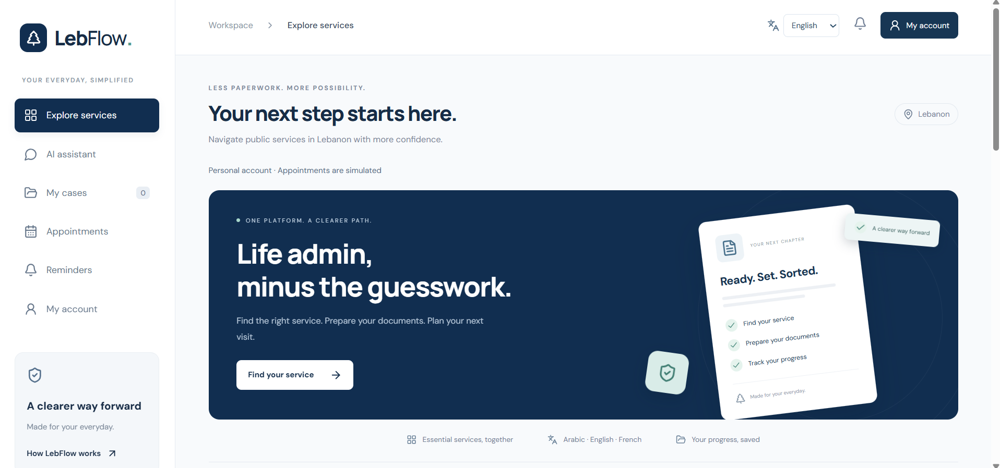
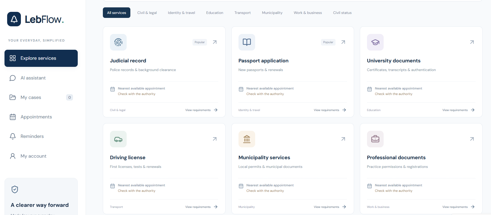
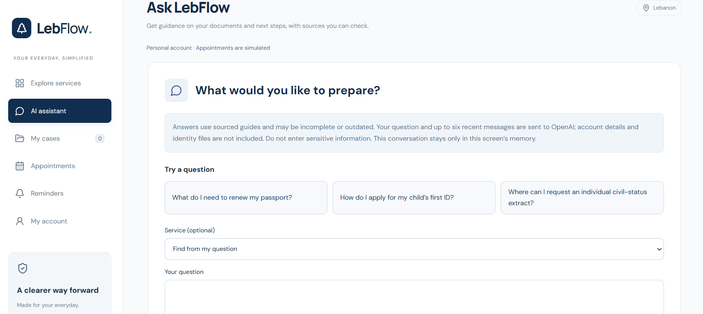

# LebFlow 🇱🇧

**LebFlow** is a multilingual full-stack web application that helps people understand and prepare Lebanese administrative requests. It combines service guides, private case tracking, and a source-backed AI Assistant in Arabic, English, and French.

**[Live connected application](https://lebflow-react.vercel.app)** · **[Static frontend demo](https://mohammadbakerabbas840-hash.github.io/LebFlow/)**

**Stack:** React · TypeScript · Vite · Laravel · PHP · PostgreSQL · OpenAI API · Vercel · Render

**Status:** Deployed personal portfolio project under continued testing. Not an official government service or a production-certified identity-document platform.

**Independent preparation platform:** LebFlow does not issue documents, certify identity, or book official government appointments. Appointment slots are demonstrations; case progress is self-reported. The connected frontend and Laravel API are deployed, while the static GitHub Pages demo remains separate. Additional production-readiness work is still required. See [verification results](docs/VERIFICATION.md), [security and deployment requirements](SECURITY.md), and the [portfolio draft](docs/SHARING.md).
## Application Screenshots

### Home Page


### Explore Services


### AI Assistant


---


## Live application and hosting

**Connected application:** [Open LebFlow](https://lebflow-react.vercel.app) · [AI Assistant](https://lebflow-react.vercel.app/#/assistant)

**Static GitHub Pages demo:** [Open standalone demo](https://mohammadbakerabbas840-hash.github.io/LebFlow/) · [Demo assistant page](https://mohammadbakerabbas840-hash.github.io/LebFlow/#/assistant)

The separate static GitHub Pages demonstration includes multilingual service guides, preparation checklists and browser-local case tracking. Demo profiles and uploaded files stay in memory. Real accounts, live AI chat, private document processing and server notifications require the Laravel backend; they are not provided by the static deployment. The assistant page explains this in each language.

### Vercel

The **connected frontend** is deployed in the Vercel project **lebflow-react** at `https://lebflow-react.vercel.app`. The older `lebflow.vercel.app` address serves a separate Next.js site. Import this repository using the repository root (`./`), the **Vite** preset and a free **Hobby** account for personal use. `vercel.json` configures `npm ci`, `npm run build:api`, the `dist` output directory and SPA routing. Remove any dashboard overrides for a Next.js build or a different root directory.

The `/api/*` and `/sanctum/*` routes proxy to `https://lebflow-backend.onrender.com` before the SPA fallback. The browser sends requests to its own Vercel origin, so Laravel sessions and CSRF cookies do not depend on cross-site cookies. API and session responses must not be cached. No backend keys belong in Vercel or the frontend bundle.

Set `FRONTEND_URL=https://lebflow-react.vercel.app` in the Render service's **Environment** settings. Both `Dockerfile` and `Dockerfile.render` use the runtime environment; configuring only an unused Dockerfile does not configure the live service. Laravel adds the frontend's exact host to Sanctum's allowed origins and uses it for password-reset and signed verification links. In Render, keep `APP_URL=https://lebflow-backend.onrender.com`, `APP_ENV=production`, `APP_DEBUG=false`, `SESSION_SECURE_COOKIE=true`, `SESSION_SAME_SITE=lax`, and `SESSION_DOMAIN=null` (host-only cookies). Preserve the existing `APP_KEY`. A separate `SANCTUM_STATEFUL_DOMAINS` setting is optional; if present, retain any existing trusted hostnames. If changing domains, update both the rewrite destinations and `FRONTEND_URL`; arbitrary Vercel preview domains are deliberately not trusted.

The deployed Laravel API uses a separate Render PostgreSQL database (`DB_CONNECTION=pgsql`, `DB_URL` configured as a secret). Account persistence across backend redeployments has been tested. Render free PostgreSQL is time-limited; the current database is scheduled to expire on November 24, 2026 unless upgraded or migrated. Uploaded files stored only on the Render service filesystem remain ephemeral; configure durable private object storage before accepting real documents. The Render image does not yet run the queue worker, scheduler or document scanners. The AI Assistant has been tested with its backend provider configuration; outbound email and other background services still need independent verification.

The CLI upload allowlist in `.vercelignore` includes only the React source and build configuration. Backend files, local uploads and environment files are excluded. Pushes to `main` should deploy on both providers when their Git integrations are connected. Test the production frontend through a local reverse proxy and isolated Laravel test database with:

```sh

npm run build:api

npm run test:vercel

```

For deployment from this checkout, sign in using `npx vercel login`, link the existing `lebflow-react` project and run `npx vercel --prod`. In the dashboard, deploy the latest `main` commit, not an older deployment. After deployment, `/api/v1/services` must return JSON and `/sanctum/csrf-cookie` must return 204 on the Vercel domain. Then verify registration, reload, case creation and logout in the browser.

### GitHub Pages

The existing GitHub Pages demo remains available at the link above.

The **Deploy frontend demo** workflow tests and publishes the frontend on pushes to `main`. The repository's **Settings → Pages → Source** must be **GitHub Actions**. No custom domain is needed. To check the same static build locally:

```sh

npm ci

npm run build:pages

npm run test:pages

npm run preview -- --mode pages

```

Open **http://127.0.0.1:4173/LebFlow/**. Hash links such as `#/assistant` support refresh and direct sharing. The Pages build uses `/LebFlow/` as its asset base; the Laravel build continues to use `/`. Never put backend provider keys in frontend environment variables or the Pages workflow.

## What is implemented

- Eleven multilingual guides: passports, Lebanese IDs, individual civil-status extracts, police records, driving licences, university authentication, municipality procedures, professional documents, birth registration, family civil-status extracts and marriage certificate copies. Coverage varies; partial guides and uncertain fees are labelled.

- Requirements before request creation, source links and review dates, passport/ID/civil-status personalization, readiness checklists and six tracking stages.

- Parent/dependent profiles, separate applications for each applicant, case history, archives and repeat requests. Family identity fields are encrypted in the database.

- Preferred dates, simulated appointment selection/rescheduling/cancellation, printable checklists and tentative calendar exports. The sourced office directory currently contains one DGCS information office; it is not a complete branch finder.

- Registration with Arabic and English names, birth date, email, password and consent. **ID number, ID image and individual civil-status extract are optional.** Parents can start a child's first-document request without those attachments.

- Account settings, private upload replacement/deletion, encrypted document storage, scan quarantine and administrator review. OCR checks consistency and never certifies authenticity.

- Password recovery, signed email-verification links, optional authenticator MFA with single-use recovery codes, active-session revocation and opt-in email reminder jobs. Administrators must use MFA. Delivery still requires an outbound email provider.

- Editorial drafts in all three languages, a second administrator's approval, version history, case-change notifications and queued public-knowledge reindexing. Published editorial versions survive catalogue reseeding.

- A dedicated AI Assistant page in the sidebar, with multilingual example questions, service selection and links from service details. Connected mode includes Qdrant retrieval with current-content checks, cited answers, bounded follow-up context, optional official-source research and answer reporting for administrator review.

## Run through Laravel

The selected backend is **`LebFlow/`** inside this workspace. The separate `my-laravel-app/` is unused and excluded from publication.

```sh

npm install

cd LebFlow

composer install

# Fresh checkout only: copy .env.example to .env, then generate the key once.

php artisan key:generate

php artisan migrate

php artisan db:seed

cd ..

npm run build:laravel

npm run backend:dev

```

Open **http://localhost:8000** or **http://127.0.0.1:8000**. Use one hostname consistently for cookie authentication. Rebuild after frontend changes. On Windows PowerShell, use `npm.cmd` if script execution is restricted.

Do not regenerate an existing application's encryption key: existing encrypted data depends on it. SQLite is the development default. No sample account or administrator is created by seeding.

For connected frontend hot reload, run `npm run dev:api` in another terminal; it serves port 5176 and proxies Laravel. `npm run dev` runs the standalone frontend demonstration: demo profiles/files stay in memory and anonymous cases stay in localStorage. Connected mode uses Laravel and account-scoped storage.

If Vite's bundled config loader is blocked by workspace filesystem restrictions, Node 24 can build using:

```sh

node node_modules/typescript/bin/tsc -b

node node_modules/vite/bin/vite.js build --mode api --configLoader native

node scripts/publish-frontend.cjs

```

The launcher permits two 5 MiB uploads. Configure equivalent PHP/server request limits under another web server; each file remains limited to 5 MiB. ID uploads accept JPEG/PNG/WebP; civil-status extracts also accept PDF. No identity file is exposed through a public storage link.

## Background services and administration

```sh

cd LebFlow

php artisan queue:work --queue=documents,default --timeout=65 --tries=2

# Separate terminal/worker:

php artisan queue:work --queue=knowledge --timeout=300 --tries=3

# Separate terminal, or production scheduler:

php artisan schedule:work

```

Use a queue retry interval longer than 300 seconds; the proposed Redis deployment uses 360. Configure an SMTP provider before expecting verification, recovery or reminder emails. The development log mailer does not deliver email. Reminders require verified email and explicit opt-in, and are scheduled at 08:00 Beirut time.

For editorial access, create two separate accounts, enrol their authenticators, then grant each explicitly on the server:

```sh

php artisan account:administrator editor@example.test

php artisan account:administrator reviewer@example.test

```

Replace these examples with the intended accounts. Administrators sign in with MFA; authors cannot approve their own revisions. `account:administrator EMAIL --revoke` removes the role. No role is granted automatically.

Source data lives in `src/data/serviceContent.ts` and `src/data/civilServices.ts`. For reviewed file-based edits, run `npm run catalog:export`, then `php artisan db:seed` in the backend. Seeding updates version-1 guides and preserves published versions above 1. Use the editor/reviewer workflow for those guides. Reindex public knowledge after changes.

The release migration is forward-only to preserve family case history. Take and test a coordinated database/file backup before upgrading; rollback requires restoring that backup.

## RAG assistant

In the connected Laravel application, open **AI Assistant** from the sidebar and sign in. Service details also link to the full page with that service selected. Up to six previous messages are supplied as untrusted follow-up context; chat stays in browser memory. Questions and that context go to the configured AI provider. Do not enter private identity information. Reporting an answer explicitly stores the reported question/answer excerpt for administrator review; this is separate from the public vector index.

Retrieval follows `question embedding → Qdrant → current SQL guide/fingerprint validation → structured answer and citations`. Selecting a service reads its current guide directly. Keyword retrieval is available during vector outages. Stale or deleted guide sections cannot supply evidence. Only public service fields are indexed; accounts, family records, cases and identity uploads are excluded.

Set `OPENAI_API_KEY` and `OPENAI_MODEL` only in backend configuration. The model must support Responses API structured outputs. Set `RAG_VECTOR_ENABLED=true` and optionally `RAG_RESEARCH_ENABLED=true`. The latter searches an allowlist of government sources and may take up to 75 seconds. Research does not automatically publish new requirements. Evidence membership and structured-output validation cannot guarantee factual accuracy; unsupported questions may be declined.

```sh

cd LebFlow

php artisan knowledge:index

php artisan knowledge:check

php artisan ai:check

# Optional live checks use paid provider requests:

php artisan ai:check --live

php artisan ai:check --research

```

Indexing and vector checks also use paid provider requests. The last confirmed live index contains 108 sections from the original eight guides. The three new guides are in SQL and available through direct/keyword retrieval; their live vector reindex remains pending. Qdrant is bound to loopback locally and must remain private in production. See [SECURITY.md](SECURITY.md) for model/collection migration and provider limitations.

## API and architecture

The API prefix is `/api/v1`. Obtain `/sanctum/csrf-cookie` before mutations. Public endpoints expose service guides, simulated appointment options and the sourced directory. Authenticated endpoints cover profiles/preferences, family members, cases/history/archives, identity uploads, security/sessions, notifications and assistant feedback. Administrator routes require MFA. Validation returns 422, owner-scoped missing resources return 404, quarantined downloads return 423, and rate limiting returns 429.

```text

React/TypeScript

  components/  shared layout, accounts, services, cases, appointments

  pages/       explore, AI assistant, cases, appointments, reminders, account

  features/    auth, preparation wizards, case and appointment flows

  services/    API and demo adapters

  hooks/       resource loading, mutations, cases and local demo storage

  data/        multilingual service content and preparation rules

  i18n/        shared English, Arabic and French text

          |

Laravel API — sessions, validation, ownership, editorial review

          |

SQL + encrypted private files — queues — private Qdrant

          |

AI provider / reviewed official public sources

```

Hash routes support direct links and browser history, including applicant-specific case links. Arabic uses RTL; reduced-motion preferences, keyboard controls, loading/retry/empty states and responsive layouts are included.

## Verification and launch status

```sh

npm test

npm run test:browser

npm run test:backend-browser

npm run format:check

node scripts/publication-check.cjs

cd LebFlow

php artisan test --compact

php artisan documents:check --live

php artisan release:check

```

Connected Playwright tests use an isolated SQLite database and synthetic uploads on port 8010. Provider responses are mocked in automated browser tests. Development port 8000 is left alone. Browser coverage is Chrome, including English/Arabic/French at 375, 768 and 1440 pixels; it is not universal browser certification.

Tesseract and ClamAV executables are available locally, but OCR language data and antivirus signatures are still missing. Live scanner verification therefore fails and uploads remain quarantined. The connected frontend and Laravel backend are hosted over HTTPS, with PostgreSQL persistence tested across redeployments. Outbound email, background workers, durable private file storage, production capacity testing, backup restoration and an independent security review remain launch requirements. Deployment does not mean the platform is ready to accept real identity information.

See [docs/VERIFICATION.md](docs/VERIFICATION.md) for actual test results and limitations and [docs/requirements-research.md](docs/requirements-research.md) for the earlier source review. Source review dates are per-guide and are not automatically refreshed by builds. Unknown current fees remain unknown.
